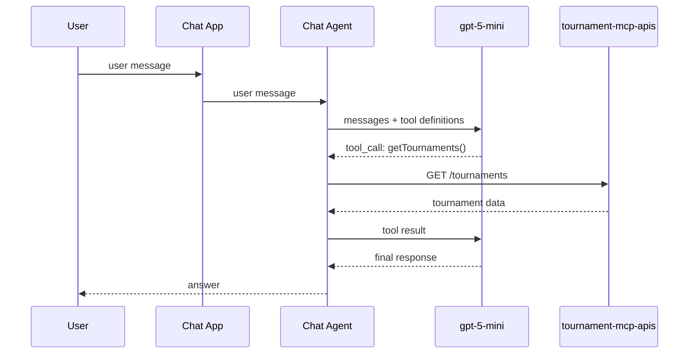
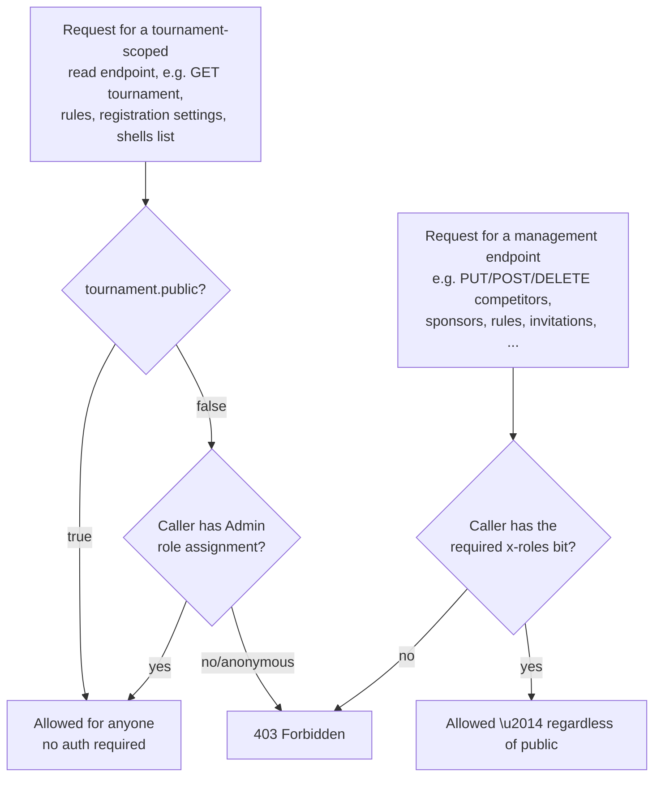
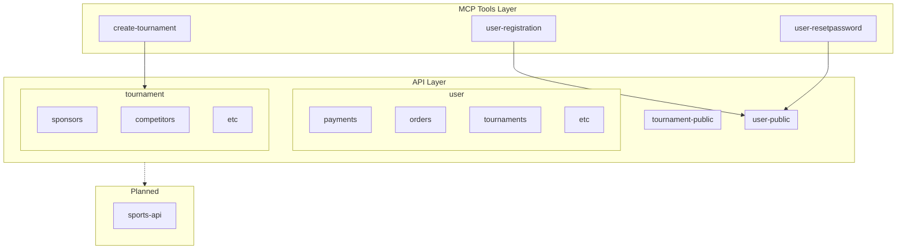
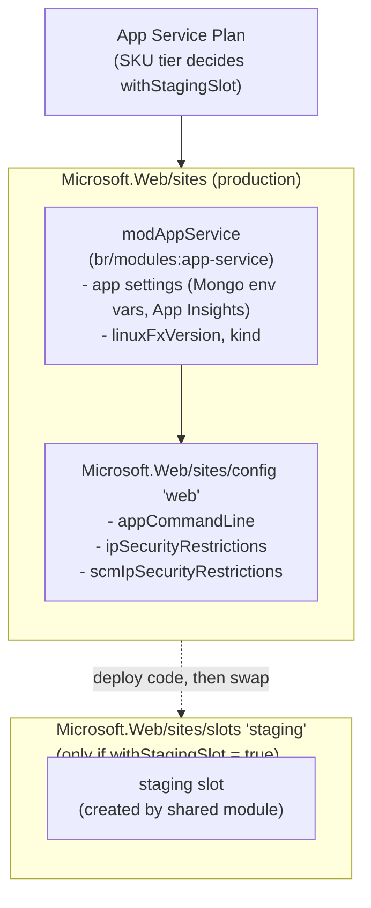
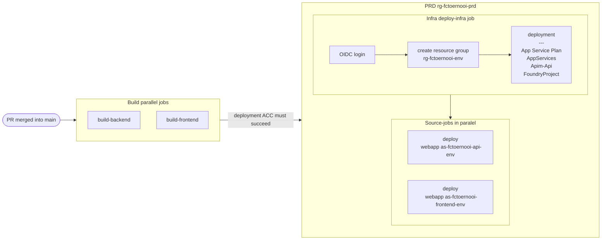
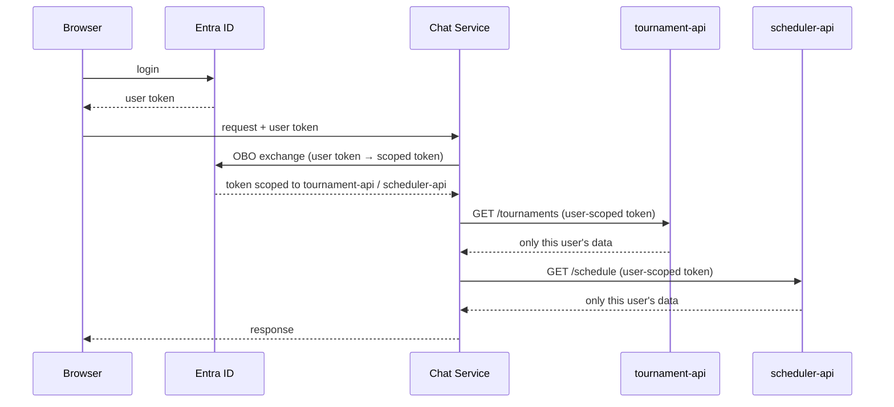

# FCToernooi ChatApp

Chat assistant that helps logged-in users manage tournaments using the tournament-mcp-apis.


## Architecture



The LLM decides when to call a tool based on the user's question. The chat service executes the actual API call and returns the result to the LLM, which then formulates the response.

## Authorization Model

Tournament access is governed by `Tournament.public` plus per-tournament role assignments — there are **no global user roles**, only roles scoped to a tournament via `TournamentRoleAssignment`.

### Roles

Bitmask values, sourced from `fctoernooi-api`'s `domain/Role.php` (source of truth — keep in sync, do not redefine independently):

| Role | Bit | Grants (management actions) |
|---|---|---|
| `Admin` | 1 | Everything: tournament settings, competitors, sponsors, locker rooms, recesses, rules, and (as the only role that can access a non-public tournament at all) viewing/using it when `public === false` |
| `RoleAdmin` | 2 | Manage tournament role assignments and invitations; manage registrations (list/accept/decline) |
| `GameResultAdmin` | 4 | Reserved for game-result management (not yet ported from `fctoernooi-api`) |
| `Referee` | 8 | Reserved for referee-scoped game-result edits (not yet ported from `fctoernooi-api`) |

A user can hold any combination of these bits per tournament, expressed as one `TournamentRoleAssignment.roles` integer.

### Visibility — `Tournament.public`

`Tournament.public: boolean`, **defaults to `true`** when a tournament is created.



- `public === true`: the tournament, its rules, registration settings, and shells listing are readable by anyone (no auth), and anyone can submit a registration to it.
- `public === false`: only a caller holding the `Admin` role assignment for that tournament may view or use it at all — no other role, and no anonymous access.
- **Management actions never become open just because a tournament is public.** Creating/editing/deleting competitors, sponsors, locker rooms, recesses, rules, invitations, registrations (list/accept/decline), registration settings, tournament PUT/DELETE, and role assignments always require their specific role bit (declared per-operation via the `x-roles` vendor extension in `openapi.yaml`), independent of the `public` flag.

### Data model invariant

`TournamentRoleAssignment` is the **only** link between a `User` and a `Tournament` (fields: `tournamentId`, `userId`, `roles` bitmask). `Tournament` itself never carries a direct `userId`/owner field — every access path goes through this join. A tournament always has at least one `Admin` assignment, created atomically alongside the tournament itself (no tournament can exist without an admin).

### Enforcement

`openapi.yaml` has no `/public/*` path prefix — the split shown in the old PHP API (`fctoernooi-api-old`) was purely a URL convention and is not needed anymore now that visibility is driven entirely by the `public`/role rules above. `x-roles` per operation in `openapi.yaml` documents the required role for management endpoints; `source/backend/src/server.ts` enforces it with explicit inline `getTournamentRoleAssignment`/`hasRole` checks per handler (matching the rest of the codebase's style, not a generic spec-reading middleware). The general public/private visibility rule (endpoints with no `x-roles`) is applied via a shared `canViewNonPublicTournament(tournamentId, userId)` helper, called explicitly from each affected handler (tournament GET, rules GET, registration-settings GET, registration submit).

## Functional Decisions

Decisions about accounts and tournaments. Source of truth for behaviour: `infra/openapi.yaml`; implementation: `source/backend` (API) and `source/frontend` (web UI).

### Accounts

| Topic | Decision |
|---|---|
| Registration | Via emailaddress + password (min. 8 characters). Users are stored in MongoDB (`users`), passwords as bcrypt hash. |
| Identifier | The emailaddress is the login. It is always stored and compared trimmed + lowercase (`Jan@X.nl` and `jan@x.nl` are the same account). The numeric `id` is the stable internal key (in the JWT and in `TournamentRoleAssignment`), because the emailaddress can change. |
| Validation | After registering (and after every emailaddress change) a validation email with a one-time link is sent. Login does not require a validated address. Changing the emailaddress resets `validated` to `false`. |
| Password reset | `POST /auth/passwordreset` always answers `200`, whether or not the address exists (no account enumeration). The email contains a one-time link; the link is valid for 1 hour and can be used once. |
| One-time tokens | Validation (24 h) and reset (1 h) tokens are random (`crypto.randomBytes`), only a SHA-256 hash and the expiry are stored in MongoDB. |
| Email delivery | Behind a `Mailer` interface (`source/backend/src/mailer.ts`). Currently only a log transport: the link is written to the application log and **no email is sent**. To do: Azure Communication Services Email. |
| Session | The Angular app keeps the API's JWT (8 h) in `localStorage` and sends it as `Authorization: Bearer` through an `HttpClient` interceptor. A `401` on a call with a token logs the user out ("de sessie is verlopen"). Because the token is readable by scripts, the Express server sends a strict CSP (`script-src 'self'`, no inline scripts). |
| Logout | Client-side only: the token is removed from `localStorage`. The JWT itself stays technically valid until it expires (no server-side revocation). |
| Profile | The user can change `name` and `emailaddress` (own account only). Only these fields are writable; flags such as `validated` or `nrOfCredits` never are. |

### Authentication & authorization

1. You have to be authenticated (JWT) for everything except: registering, logging in, password reset/change, and reading public tournaments.
2. Authorization is done **only** via tournament roles (see "Authorization Model"). There are no global roles and no tournament owner.
3. Updating and deleting a tournament requires the `Admin` role on that tournament, regardless of `public`.

### Tournaments

| Topic | Decision |
|---|---|
| Key properties | Three properties are required/central: `name` (max 100), `startDateTime`, `public` (default `true`). `location`, `intro` (description) and `theme` are optional. Older documents without `name`/`startDateTime` fall back to `intro` / `createdDateTime`. |
| Storage | MongoDB (`tournaments`). Fields of the request are whitelisted (`example`, `createdDateTime`, ... cannot be set by the client). |
| Creating | `POST /tournaments` creates the tournament and the creator's role assignment (`Admin`, `RoleAdmin`, `GameResultAdmin`) together. |
| "My tournaments" | There is no owner field. "Mijn toernooien" is derived from role assignments: `GET /shellswithrole?roles=<bitmask>` (the web UI asks for all roles). The roles of the user are shown per tournament. |
| Deleting | `DELETE /tournaments/{id}` removes the tournament **and everything scoped to it**: competitors, sponsors, locker rooms (+ their competitor links), recesses, rules, invitations, registrations, registration settings and all role assignments. |
| Time zone | The API stores and returns UTC instants; the UI shows them in the browser's local time. |

### Frontend (Angular)

| Topic | Decision |
|---|---|
| Stack | Same as the old app in `fctoernooi-deprecated`: Angular 22 (standalone, zoneless), ng-bootstrap, Bootstrap 5 + Bootswatch Sandstone with the same Sass (`src/sass`), Font Awesome, i18n (`messages.nl.xlf`). No `ngx-sport` (sport/competition specific, not needed yet). Mobile first: every screen must look right from **400 px** wide upwards (this is the one place that number is defined; do not hard-code it in the app) and is compared with the old app at that width. |
| Scope | Everything outside sport/competition, built module by module. Done: **user** (login, register, password reset/change, validate, profile, delete account). Next: home/tournament list, new tournament, name & theme, authorizations, sponsors, locker rooms, rules, start & recesses, registration. Not included yet: structure, competitors, games, ranking, referees, fields, planning, liveboard, buy credits/payments. |
| Hosting | Static build (`ng build -c prod,nl` → `dist/browser`) served by `server/server.ts` (Express, `node dist/server.js`) with an SPA fallback. No SSR/prerender. |
| API base URL | The browser calls the API (APIM, `…/fctoernooi-api/v1`) directly. The Express server injects `FCTOERNOOI_API_BASEURL` at runtime through `/config.js`, so one build runs in every environment. |
| CORS | Needed because of the direct calls: APIM must allow the frontend origin (`https://as-fctoernooi-frontend-<env>.azurewebsites.net`; dev also `http://localhost:4200`), methods GET/POST/PUT/DELETE/OPTIONS, headers `Authorization` and `Content-Type`, no credentials. The backend itself has no CORS, except the opt-in `CORS_ALLOWED_ORIGINS` for local development. |
| Registration / password change | The API answers `register` (201) and `passwordchange` (200) without a token, so the app logs in right after. The reset email contains a link with the one-time token; the form shows it prefilled in the "code" field. |
| Validation email | The link is `/user/validate/<code>` (the same route as in the old app). |
| Colour mode | Follows the system colour scheme until the user toggles it (stored in `localStorage`). |

### Not decided / postponed

- **MCP tools** (`user-register`, `user-login`, `user-logout`, `user-profile`, `password-reset`, workflow-oriented rather than 1:1 API operations) are deliberately postponed. `infra/mcp-tools.json` is unchanged for now.
- Server-side logout (token revocation), real email delivery and a managed `JWT_SECRET` (see below) are follow-ups.

> **Known gap:** the infra does not yet provision `JWT_SECRET` for the backend App Service. Without it the backend signs tokens with an insecure built-in development secret (a warning is logged at start-up). Add it to Key Vault + the backend app settings before relying on this outside dev.

## Component List
|name|function|
|-|-|
|User|Logged-in tournament organizer/user interacting with the assistant|
|Chat App|Frontend UI that sits between the user and the agent|
|Chat Agent|Backend service that orchestrates the conversation, calls the LLM and invokes API tools|
|gpt-5-mini|LLM that interprets user intent and decides which tool to call|
|tournament-mcp-apis|MCP layer exposing tournament/user tools on top of the underlying APIs|


## Tournament MCP APIs

`tournament-mcp-apis` is an MCP layer sitting on top of the existing API layer. MCP tools are the only thing the LLM ever calls — each tool internally invokes one or more of the underlying APIs.



| Layer | Item | Notes |
|---|---|---|
| MCP tool | `user-registration` | Registers a new user via `user-public` |
| MCP tool | `user-resetpassword` | Resets a user's password via `user-public` |
| MCP tool | `create-tournament` | Creates a tournament via `tournament` |
| API | `user-public` | Unauthenticated user actions (registration, password reset) |
| API | `tournament-public` | Unauthenticated tournament read endpoints |
| API | `user` | Authenticated user endpoints — payments, orders, tournaments, etc. |
| API | `tournament` | Authenticated tournament endpoints — sponsors, competitors, etc. |
| Planned | `sports-api` | Not yet implemented |

## ProjectDetails - Technical

| Section | Bicep / command | Resources |
|---|---|---|
| **Infra** | `infra/main.bicep` + `infra/parameters.json` (env-specific values passed as extra `--parameters key=value` overrides in CI) | App Service Plan (`rg-fctoernooi-<env>`), backend App Service (APIM-restricted), frontend App Service, APIM backend + API + product (in `rg-core-<env>`) |
| **Source — backend** | `az webapp deploy` → staging slot → swap | `as-fctoernooi-api-<env>` |
| **Source — frontend** | `az webapp deploy` → staging slot → swap | `as-fctoernooi-frontend-<env>` |

#### App Service / Slot / Config relationship

`infra/modules/app-service.bicep` wraps the shared `br/modules:app-service` module, then attaches a `config` (`web`) child resource for settings the shared module doesn't expose as parameters. The staging slot only exists when the plan tier is `Standard` (`withStagingSlot`) and does not get its own `config` resource here — it inherits the site-level config until swapped.



## API's


####  Keys & Secrets
All keys live in the **backend chat service** — never in the browser.

| Secret | Storage |
|---|---|
| Azure OpenAI `api-key` | Azure Key Vault → env var |
| tournament-api key | Azure Key Vault → env var |
| scheduler-api key | Azure Key Vault → env var |
| Local dev | `.env` file (gitignored) |
| GitHub Actions | GitHub Secrets |

## CI/CD Pipeline

#### Triggers & environment flow

**push to non-main branch**



#### Trigger rules

| Event | Condition | Environment |
|---|---|---|
| `push` | any branch except `main` | dev |
| `pull_request` closed | `merged == true` into `main` | acc |
| after acc succeeds | — | prd |

#### Hosted agent deployment (`azd`) prerequisites

The `Deploy hosted agents` CI step (`.github/workflows/_deploy-env.yml`) runs `azd provision`/`azd deploy`
against each `infra/agents/hosted-agents/*/azure.yaml`, using the same OIDC-federated CI service
principal as the rest of the workflow (`azd auth login --federated-credential-provider github`).
This has one-time, per-environment manual setup that the pipeline itself cannot create:

- The CI service principal needs the **"Role Based Access Control Administrator"** role
  (`f58310d9-a9f6-439a-9e8d-f62e7b41a168`) on azd's own resource group for that environment
  (`rg-<env>`, e.g. `rg-dev` — NOT the same resource group as the main bicep deploy,
  `rg-fctoernooi-<env>`). Without it, `azd provision` fails provisioning the agent's role
  assignment (granting the agent's managed identity access to the Foundry project) with
  `Authorization failed ... Microsoft.Authorization/roleAssignments/write`.
  Grant it once per environment, e.g.:
  ```bash
  az role assignment create \
    --assignee-object-id <CI_SP_OBJECT_ID> --assignee-principal-type ServicePrincipal \
    --role f58310d9-a9f6-439a-9e8d-f62e7b41a168 \
    --scope /subscriptions/<SUB_ID>/resourceGroups/rg-<env>
  ```
- `azd env set AZURE_LOCATION westeurope` is set explicitly by the workflow for freshly created
  `azd` environments (azd doesn't inherit it from anywhere else automatically).

## User Privacy & Data Isolation

The chat service must call the tournament-api and scheduler-api **in the name of the logged-in user** using the OAuth On-Behalf-Of (OBO) flow. Data filtering is enforced at the API level — never by the LLM.



**Rules:**
- The tournament-api and scheduler-api validate the bearer token and only return data owned by that user (`oid`/`sub` claim)
- The LLM never sees tokens or keys
- Even a prompt injection attack cannot access another user's data — the token has no permission for it

## Infrastructure

Azure AIServices (`kind: 'AIServices'`) deployed via Bicep + GitHub Actions.

**Endpoint pattern:**
```
https://aoai-fctoernooi-{env}.cognitiveservices.azure.com/openai/v1/chat/completions?api-version=2025-04-01-preview
```

Environments: `dev` (capacity 10) · `acc` (capacity 20) · `prd` (capacity 50)


## Approach: Function Calling (Tool Use)

The assistant uses **function calling** — not RAG or fine-tuning — because it needs live data from APIs.

| Approach | Verdict |
|---|---|
| Function calling / tools | Live API data, actions |
